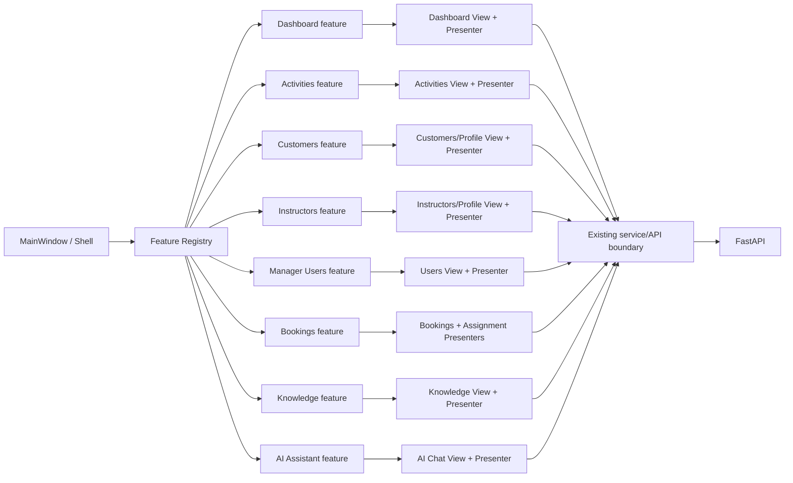

# Desktop Microfrontend Architecture

## Decision

The course requires the PySide6 Desktop subsystem to implement both MVP and
Microfrontends. In this project, Microfrontends are **feature modules inside one
Desktop executable**, not independently deployed web applications.

The final implementation keeps the tested MVP classes in their stable
layer-oriented packages (`views/`, `presenters/`, `services/`) and adds an
explicit feature-composition boundary under `desktop_client/app/features/`.
This avoids a high-risk file move while giving every business feature a small,
independently registered public interface.

## Composition

## Public feature boundary

`desktop_client/app/features/registry.py` is the only business-feature registry
used by `MainWindow`. Each `FeatureDescriptor` declares:

- a feature name;
- the roles for which the feature may be mounted;
- the page keys owned by the feature;
- one `register(context)` function.

`FeatureContext` exposes only the composition dependencies required by a feature:
the shell, authenticated session, operation executor, explicit service bundle,
Presenter registry, and application-level navigation/booking-refresh callbacks.
A feature registers its own View, Presenter, signal wiring, and page ownership.

The shell therefore does not need to import or wire `CustomersView`,
`BookingsPresenter`, `AIChatView`, or the other business-feature internals.

## Feature ownership

| Feature | Roles | Owned page(s) | MVP boundary |
|---|---|---|---|
| Authentication | all | Login | `LoginView -> LoginPresenter -> AuthService` |
| Dashboard | manager, instructor, customer | `dashboard` | `DashboardView -> DashboardPresenter -> BookingService` |
| Activities | all | `activities` | `ActivitiesView -> ActivitiesPresenter -> ActivityService` |
| Customers | manager/customer | `customers`, customer `my_profile` | customer Views -> customer Presenters -> `CustomerService`/`UserService` |
| Instructors | manager/instructor | `instructors`, instructor `my_profile` | instructor Views -> instructor Presenters -> `InstructorService`/`UserService` |
| Manager Users | manager | `users` | `UsersView -> UsersPresenter -> UserService` |
| Bookings | all | `bookings` / `my_bookings` | `BookingsView -> BookingsPresenter`; manager assignment Presenter shares the same booking details surface |
| Knowledge | manager | `knowledge` | `KnowledgeManagementView -> KnowledgeManagementPresenter -> KnowledgeService` |
| AI Assistant | all | `ai_chat` | `AIChatView -> AIChatPresenter -> AIChatService` |

## Cross-feature communication

Features do not call each other's Views directly. The only intentional
application-level integrations are composed through the shared context/Presenter
registry:

1. Dashboard drill-down calls the application navigation callback with a target
   feature key and optional filters.
2. Manager Booking creation connects the Dashboard's existing create-booking
   intent to the mounted Booking Presenter.
3. Booking mutations call the application booking-refresh callback, which
   refreshes Dashboard and the role-appropriate Booking page.

These are composition concerns rather than domain/business logic. Backend
authorization remains authoritative.

## Why the implementation does not move every class

The existing View/Presenter/Service files are already heavily regression-tested
and have stable imports. Moving all of them into new physical directories would
change import paths across the application and tests without improving runtime
behavior. The feature registration façade provides the required Microfrontend
boundary while preserving the current UI, signals, Presenter behavior, services,
and tests.

## Verification

`desktop_client/tests/test_microfrontends.py` protects three architecture rules:

- the registry exposes explicit bounded features;
- `MainWindow` composes through the feature registration boundary instead of
  importing business Views/Presenters directly;
- role boundaries are declared at the feature-registry level.

Existing role-composition tests continue to verify that Manager, Instructor and
Customer receive the same pages and navigation as before.
