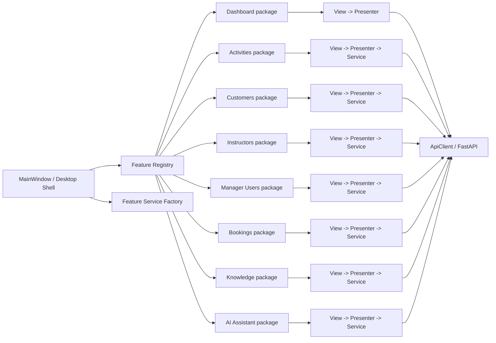

# Desktop Microfrontend Architecture

## Decision

The course requires the PySide6 Desktop subsystem to implement both MVP and
Microfrontends. In this project, Microfrontends are **feature-first packages
inside one Desktop executable**. They are not independently deployed web
bundles.

The final Desktop structure makes the business boundaries visible in the source
tree: every business capability owns its registration, View, Presenter and
service adapter under `desktop_client/app/features/<feature>/`. Reusable shell,
visual and validation infrastructure lives under `desktop_client/app/shared/`.

This refactor is structural only. It does not intentionally change UI widgets,
RTL behavior, styling, signals, API calls, authorization, Event Sourcing, RAG,
or business rules.

## Physical structure

```text
desktop_client/app/
├── main.py                         # Desktop shell/composition root
├── features/
│   ├── registry.py                 # feature catalogue + role ownership
│   ├── contracts.py                # composition contract
│   ├── service_factory.py          # shared service instances
│   ├── auth/
│   │   ├── registration.py
│   │   ├── view.py
│   │   ├── presenter.py
│   │   └── service.py
│   ├── dashboard/
│   ├── activities/
│   ├── customers/
│   ├── instructors/
│   ├── users/
│   ├── bookings/
│   ├── knowledge/
│   └── ai_assistant/
├── shared/
│   ├── navigation.py
│   ├── formatting.py
│   ├── validation/
│   └── ui/
├── api/
├── infrastructure/
├── models/
└── assets/
```

There are no parallel business `views/`, `presenters/` or `services/` trees.
Feature-specific code has one physical owner. Shared components are extracted
only when more than one feature needs them.

## Composition



## Public feature boundary

`desktop_client/app/features/registry.py` is the business-feature catalogue used
by `MainWindow`. Each `FeatureDescriptor` declares:

- feature name;
- allowed roles;
- owned page keys;
- one public `register(context)` entry point.

Each feature package owns the wiring between its View and Presenter. The shell
therefore knows **which features exist**, but it does not know how their widgets,
signals or Presenter commands are implemented.

`FeatureContext` exposes only composition dependencies: shell, authenticated
session, background executor, service bundle, Presenter registry and the small
application-level navigation/refresh callbacks needed for cross-feature flows.

## Feature ownership

| Feature | Roles | Main files | MVP boundary |
|---|---|---|---|
| Authentication | all | `features/auth/` | `view.py -> presenter.py -> service.py` |
| Dashboard | all | `features/dashboard/` | `view.py -> presenter.py`; reads booking service through the composition contract |
| Activities | all | `features/activities/` | View/dialogs -> Presenter -> Activity service |
| Customers | manager/customer | `features/customers/` | list/profile Views -> Presenters -> Customer service |
| Instructors | manager/instructor | `features/instructors/` | list/profile Views -> Presenters -> Instructor service |
| Manager Users | manager | `features/users/` | View/dialogs -> Presenter -> User service |
| Bookings | all | `features/bookings/` | Booking View/dialogs -> Booking/Assignment Presenters -> services |
| Knowledge | manager | `features/knowledge/` | View -> Presenter -> Knowledge service |
| AI Assistant | all | `features/ai_assistant/` | View -> Presenter -> AI Chat service |

## Shared code rule

A module belongs under `shared/` only when it is genuinely reused across feature
boundaries. Examples are design tokens, the shell widget, management table
foundations, generic entity-form infrastructure and account/dialog validation.
Business-specific screens, Presenters and endpoint adapters remain inside their
feature packages.

This keeps feature ownership explicit without duplicating common widgets or
validation logic.

## Cross-feature communication

Features do not call another feature's View directly. The intentional
application-level integrations remain small and explicit:

1. Dashboard drill-down calls the application navigation callback with a target
   feature key and optional filters.
2. Manager Booking creation connects the Dashboard create-booking intent to the
   mounted Booking Presenter at composition time.
3. Booking mutations call the application booking-refresh callback, which
   refreshes Dashboard and the role-appropriate Booking page.
4. Dashboard reuses the Booking read-model formatter; this is a read-only public
   dependency and does not couple Dashboard to Booking widgets or commands.

Backend authorization remains authoritative.

## Why this is a Microfrontend implementation

For this PySide6 application, the Microfrontend boundary is a **business feature
package and registration contract**, while MVP defines the internal structure of
that package. In short:

```text
Desktop Shell
  -> Feature Registry
    -> Feature package
       -> View
       -> Presenter
       -> Service/API boundary
```

The executable is still one Windows Desktop application, but each feature can
be located, reasoned about and composed independently without putting all
business wiring in `MainWindow`.

## Verification

`desktop_client/tests/test_microfrontends.py` protects the architecture by
checking that:

- the explicit role-aware feature registry exists;
- business source is physically grouped under feature packages;
- the old parallel business `views/`, `presenters/` and `services/` trees do not
  remain;
- `MainWindow` composes through public feature boundaries rather than importing
  feature Views, Presenters or services directly.

The existing Desktop regression tests continue to verify that the refactor does
not change role navigation, UI behavior or business workflows.
